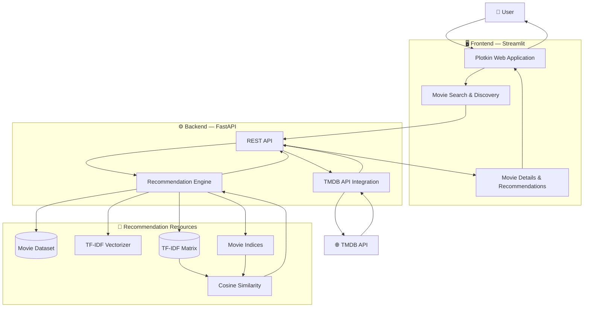

# Plotkin — Movies related by story 🎬


🌐 **Live Application:** [https://plotkin.streamlit.app/](https://plotkin.streamlit.app/)

---

## 📋 Overview

**Plotkin** is a content-based movie recommendation platform designed to help users discover movies through story, plot, and genre similarities.

Powered by **TF-IDF vectorization** and **cosine similarity**, Plotkin analyzes movie metadata to identify films with similar content and recommends titles based on the movie selected by the user.

The platform combines a locally trained recommendation pipeline with real-time movie information from **The Movie Database (TMDB) API**, delivering movie discovery through an interactive Streamlit interface backed by a FastAPI service.

Key highlights include:

- **Content-Based Filtering** — recommends movies based on similarities in their textual metadata.
- **TF-IDF Vectorization** — transforms movie content into numerical feature representations.
- **Cosine Similarity** — measures similarity between movie feature vectors to rank recommendations.
- **Movie Discovery** — explore trending, popular, top-rated, upcoming, and now-playing movies.
- **TMDB Integration** — retrieves movie details, descriptions, release dates, ratings, and posters.
- **Genre-Based Recommendations** — discover additional movies based on the selected movie's genre.
- **Interactive Search** — search for movies and explore matching results.
- **Dedicated Backend API** — FastAPI handles movie searches, details, and recommendation requests.
- **Cloud Deployment** — independently deployed backend and frontend services.

---

## 🎥 Preview


---

## 🏗️ Features

### 🎬 Movie Discovery

- **Trending Movies** — explore currently trending movies.
- **Popular Movies** — discover movies based on popularity.
- **Top Rated Movies** — browse highly rated titles.
- **Upcoming Movies** — explore upcoming releases.
- **Now Playing** — discover movies currently in theatres.
- **Movie Search** — search for movies and browse matching results.

### 🎯 Content-Based Recommendations

- **TF-IDF Feature Extraction** — converts movie metadata into numerical vectors.
- **Cosine Similarity** — calculates similarity scores between movies.
- **Similar Movie Discovery** — recommends movies with similar textual content.
- **Ranked Recommendations** — displays the most similar movies based on calculated similarity scores.

### 🏷️ Genre-Based Recommendations

- **Genre Discovery** — recommends movies based on the selected movie's genre.
- **TMDB Discover API** — retrieves relevant movies using genre information.
- **Additional Discovery** — provides another recommendation approach alongside content similarity.

### 🎞️ Movie Details & Metadata

- **Movie Overview** — view descriptions and plot summaries.
- **Release Information** — explore movie release dates.
- **Ratings** — view TMDB audience ratings.
- **Movie Posters** — display movie artwork through TMDB image resources.
- **Movie Information** — retrieve additional details using TMDB.

### ⚙️ Backend & API

- **FastAPI REST API** — dedicated backend for application functionality.
- **Asynchronous HTTP Requests** — communicates with TMDB using HTTPX.
- **Precomputed Model Artifacts** — loads serialized TF-IDF resources for recommendations.
- **Dataset Validation** — verifies dataset and model dimensions during startup.
- **API Documentation** — interactive Swagger documentation.

### ☁️ Deployment

- **Render** — hosts the FastAPI backend.
- **Streamlit Community Cloud** — hosts the frontend.
- **Environment Variables** — keeps API credentials separate from source code.
- **Production API Configuration** — connects the deployed frontend to the backend.

---

## 💻 Technologies Used

### **Programming Language & Data Processing**

- [**Python**](https://www.python.org/) — primary programming language.
- [**Pandas**](https://pandas.pydata.org/) — data manipulation, cleaning, and preprocessing.
- [**NumPy**](https://numpy.org/) — numerical computations and array operations.
- [**SciPy**](https://scipy.org/) — sparse matrix operations and efficient similarity calculations.

### **Machine Learning & NLP**

- [**Scikit-learn**](https://scikit-learn.org/) — machine learning utilities and TF-IDF vectorization.
- [**TF-IDF (Term Frequency–Inverse Document Frequency)**](https://scikit-learn.org/stable/modules/feature_extraction.html#text-feature-extraction) — converts textual movie metadata into numerical feature vectors.
- [**Cosine Similarity**](https://scikit-learn.org/stable/modules/metrics.html#cosine-similarity) — measures similarity between movie feature vectors.
- **Content-Based Filtering** — recommendation approach based on movie content and metadata.

### **Frontend**

- [**Streamlit**](https://streamlit.io/) — interactive web application framework.
- [**Requests**](https://requests.readthedocs.io/) — communicates with the backend API.

### **Backend**

- [**FastAPI**](https://fastapi.tiangolo.com/) — high-performance Python API framework.
- [**Uvicorn**](https://www.uvicorn.org/) — ASGI server for running the backend.
- [**HTTPX**](https://www.python-httpx.org/) — asynchronous HTTP client for TMDB API requests.
- [**Pydantic**](https://docs.pydantic.dev/) — data validation and response models.
- [**Python-dotenv**](https://github.com/theskumar/python-dotenv) — environment variable management.

### **External API & Data**

- [**The Movie Database (TMDB) API**](https://developer.themoviedb.org/docs) — movie search, details, genres, ratings, and posters.
- [**TMDB Image API**](https://developer.themoviedb.org/docs/image-basics) — movie poster and backdrop images.

### **Development & Deployment**

- [**Google Colab**](https://colab.research.google.com/) — notebook-based data processing and model development.
- [**Jupyter Notebook**](https://jupyter.org/) — local development and experimentation.
- [**Git & GitHub**](https://github.com/) — version control and source code management.
- [**Render**](https://render.com/) — backend hosting.
- [**Streamlit Community Cloud**](https://streamlit.io/cloud) — frontend hosting.

---

## 🧱 System Architecture

Plotkin follows a frontend-backend architecture in which Streamlit handles the user interface, FastAPI processes application requests, and the recommendation engine uses precomputed TF-IDF resources.



### **How the Recommendation Engine Works**

1. **Data Collection** — movie information is collected and prepared for analysis.
2. **Data Cleaning** — relevant fields are cleaned, processed, and prepared for feature engineering.
3. **Exploratory Data Analysis** — the dataset is explored to understand its structure, distributions, and characteristics.
4. **Feature Engineering** — relevant movie metadata is combined into textual features.
5. **TF-IDF Vectorization** — textual features are converted into numerical vectors.
6. **Cosine Similarity** — similarity scores are calculated between movie vectors.
7. **Recommendation Generation** — the most similar movies are retrieved and ranked.
8. **API Integration** — FastAPI combines recommendation results with movie information from TMDB.
9. **Frontend Display** — Streamlit presents the selected movie and its recommendations.

---

## 📁 Repository Structure

```text
plotkin/
│
├── backend/
│   ├── __init__.py
│   └── main.py                  # FastAPI application and API routes
│
├── frontend/
│   └── app.py                   # Streamlit application
│
├── dataset/
│   ├── movies.csv               # Original movie dataset
│   ├── processed_movies.csv     # Cleaned movie dataset
│   └── recommendation_movies.csv # Final recommendation dataset
│
├── models/
│   ├── tfidf_matrix.pkl         # Precomputed TF-IDF matrix
│   ├── indices.pkl              # Movie title-to-index mapping
│   └── tfidf.pkl                # Fitted TF-IDF vectorizer
│
├── notebooks/
│   ├── 01_data_gathering_and_cleaning.ipynb
│   ├── 02_exploratory_data_analysis.ipynb
│   ├── 03_feature_engineering.ipynb
│   └── 04_content_based_filtering.ipynb
│
├── docs/
│   └── preview.gif              # Application preview
│
├── .env.example                 # Environment variable template
├── .gitignore
├── requirements.txt
├── LICENSE
└── README.md
```

---

## 🚀 Getting Started

### **Prerequisites**

- **Python 3.13** (or a compatible version for the pinned dependencies)
- **Git**
- **pip** package manager
- A **TMDB API key** from [The Movie Database](https://www.themoviedb.org/settings/api)

### **1. Clone the Repository**

```bash
git clone https://github.com/huzaifa-ai-ml/plotkin.git
cd plotkin
```

### **2. Create a Virtual Environment**

**Windows (PowerShell):**

```powershell
python -m venv .venv
.\.venv\Scripts\Activate.ps1
```

**macOS / Linux:**

```bash
python -m venv .venv
source .venv/bin/activate
```

### **3. Install Dependencies**

```bash
python -m pip install -r requirements.txt
```

### **4. Configure Environment Variables**

Create a `.env` file in the project root directory.

```env
TMDB_API_KEY=your_tmdb_api_key_here
```

The `.env.example` file provides a template for the required environment variable.

> **Important:** Never commit your actual `.env` file or expose your TMDB API key publicly.

### **5. Run the Backend**

From the project root:

```bash
python -m uvicorn backend.main:app --reload
```

The FastAPI backend will be available at:

```text
http://127.0.0.1:8000
```

Interactive API documentation:

```text
http://127.0.0.1:8000/docs
```

### **6. Run the Frontend**

Open a second terminal, activate the virtual environment, and execute:

```bash
streamlit run frontend/app.py
```

The Streamlit application will be available at:

```text
http://localhost:8501
```

### **7. Explore Plotkin**

Open the Streamlit application in your browser and start discovering movies.

---

## 🩺 API Endpoints

The FastAPI backend exposes the following endpoints:

| Method | Endpoint | Description |
|---|---|---|
| `GET` | `/health` | Backend health check |
| `GET` | `/home` | Retrieve movie discovery feeds |
| `GET` | `/tmdb/search` | Search for multiple movies using TMDB |
| `GET` | `/movie/id/{tmdb_id}` | Retrieve movie details |
| `GET` | `/recommend/genre` | Generate genre-based recommendations |
| `GET` | `/recommend/tfidf` | Retrieve TF-IDF recommendations |
| `GET` | `/movie/search` | Retrieve movie details and recommendation results together |

### **Example Requests**

```http
GET /health
GET /home?category=trending
GET /tmdb/search?query=Inception
GET /movie/id/27205
GET /recommend/genre?tmdb_id=27205
GET /recommend/tfidf?title=Inception&top_n=10
GET /movie/search?query=Inception
```

### **API Documentation**

Explore and test all available endpoints through the interactive Swagger interface:

[Plotkin API Documentation](https://plotkin-backend.onrender.com/docs)

---

## ☁️ Deployment

Plotkin is deployed using separate hosting platforms for its backend and frontend.

### **Production Deployment**

| Component | Platform | URL |
|---|---|---|
| Frontend | Streamlit Community Cloud | [plotkin.streamlit.app](https://plotkin.streamlit.app/) |
| Backend | Render | [plotkin-backend.onrender.com](https://plotkin-backend.onrender.com/) |
| API Documentation | FastAPI Swagger UI | [OpenAPI Docs](https://plotkin-backend.onrender.com/docs) |

### **Backend — Render**

The FastAPI application is deployed as a Render Web Service.

**Build Command:**

```bash
pip install -r requirements.txt
```

**Start Command:**

```bash
uvicorn backend.main:app --host 0.0.0.0 --port $PORT
```

**Environment Variables:**

```env
TMDB_API_KEY=your_tmdb_api_key
```

### **Frontend — Streamlit Community Cloud**

The Streamlit application is deployed using the following configuration:

- **Repository:** `huzaifa-ai-ml/plotkin`
- **Branch:** `main`
- **Main file:** `frontend/app.py`

**Streamlit Secrets:**

```toml
API_BASE = "https://plotkin-backend.onrender.com"
```

The frontend uses this configuration to communicate with the deployed FastAPI backend.

---

## 🔐 Security & Configuration

- **Environment Variables** — sensitive credentials are stored outside the source code.
- **API Key Protection** — TMDB API credentials are configured through environment variables and deployment secrets.
- **Git Exclusions** — `.env`, virtual environments, and generated Python cache files are excluded from version control.
- **Backend Validation** — Pydantic models validate structured API responses.
- **HTTP Error Handling** — backend requests handle network failures and external API errors.

---

## 📄 License

This project is licensed under the [MIT License](LICENSE) - see the [LICENSE](LICENSE) file for details.

---

## ✍️ Author

**Muhammad Huzaifa Karim**  
[GitHub Profile](https://github.com/huzaifakarim1)

---

## 🙏 Acknowledgments

- **The Movie Database (TMDB)** — movie metadata, posters, and discovery API.
- **Scikit-learn** — TF-IDF vectorization and machine learning utilities.
- **Streamlit** — interactive frontend framework.
- **FastAPI** — backend API framework.
- **Google Colab** — notebook-based model development and experimentation.

---

## 📬 Contact

For questions, feedback, or support:

- **GitHub Issues** - Report bugs or request features
- **Email** - karimhuzaifa590@gmail.com

---

## 🌟 Show Your Support

If you found this project helpful, please consider:

- ⭐ Starring the repository.
- 🐛 Reporting bugs or issues.
- 💡 Suggesting improvements.
- 📢 Sharing the project.
- 🤝 Contributing to the codebase

---

© 2026 Muhammad Huzaifa Karim
